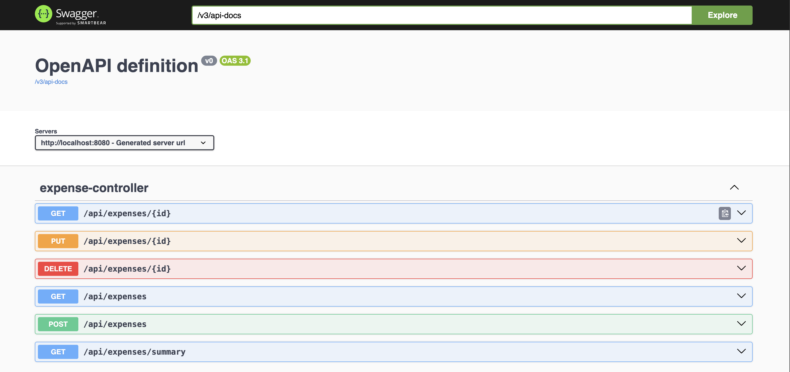
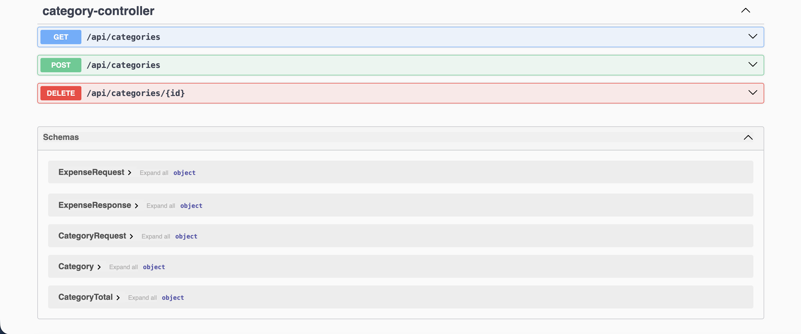

# Expense Tracker API


A REST API for tracking personal expenses by category. Built with Java 21, Spring Boot, and PostgreSQL, fully containerized with Docker and tested automatically with GitHub Actions.

## Tech stack

- Java 21, Spring Boot (Web, Data JPA, Validation)
- PostgreSQL 16, with Flyway for versioned schema migrations
- JUnit 5, Mockito, and Testcontainers for unit and integration tests
- Docker and Docker Compose
- GitHub Actions for CI
- springdoc-openapi (Swagger UI) for API docs

## Run it

Requires Docker.

```bash
git clone https://github.com/jenniferschultzz/expense-tracker.git
cd expense-tracker
docker compose up --build
```

The API runs at `http://localhost:8080` and Swagger UI at `http://localhost:8080/swagger-ui.html`.

## API

| Method | Endpoint | Description |
|---|---|---|
| POST | `/api/categories` | Create a category |
| GET | `/api/categories` | List categories |
| DELETE | `/api/categories/{id}` | Delete a category |
| POST | `/api/expenses` | Create an expense |
| GET | `/api/expenses` | List expenses (optional `categoryId`, `from`, `to` filters) |
| GET | `/api/expenses/{id}` | Get one expense |
| PUT | `/api/expenses/{id}` | Update an expense |
| DELETE | `/api/expenses/{id}` | Delete an expense |
| GET | `/api/expenses/summary` | Total spent per category |





## Architecture

```
Client -> Controller -> Service -> Repository -> PostgreSQL
```

- **Controller:** handles HTTP, validates input
- **Service:** business logic and transactions
- **Repository:** database access via Spring Data JPA
- **DTOs:** separate request/response objects from database entities

## Design decisions

- **DTOs instead of exposing entities:** keeps the API stable if the database changes, avoids lazy-loading serialization problems, and lets validation rules live on request objects.
- **Flyway migrations:** the schema is versioned in code and identical on every machine. Hibernate only validates it (`ddl-auto: validate`).
- **`BigDecimal` for money:** avoids floating-point rounding errors.
- **Indexes** on `category_id` and `expense_date`, the columns used for filtering and grouping.
- **Global exception handler:** consistent error responses with correct status codes (400 validation, 404 not found, 409 conflict).
- **Testcontainers instead of H2:** integration tests run against real PostgreSQL, so they also verify the Flyway migrations.

## Testing

```bash
./mvnw test
```

Includes unit tests for the service layer (Mockito) and integration tests for the full HTTP stack against a real PostgreSQL container. Tests run automatically on every push through GitHub Actions.

## Possible future work

- JWT authentication with role-based access
- Pagination for the expense list
- Deployment to a cloud provider
